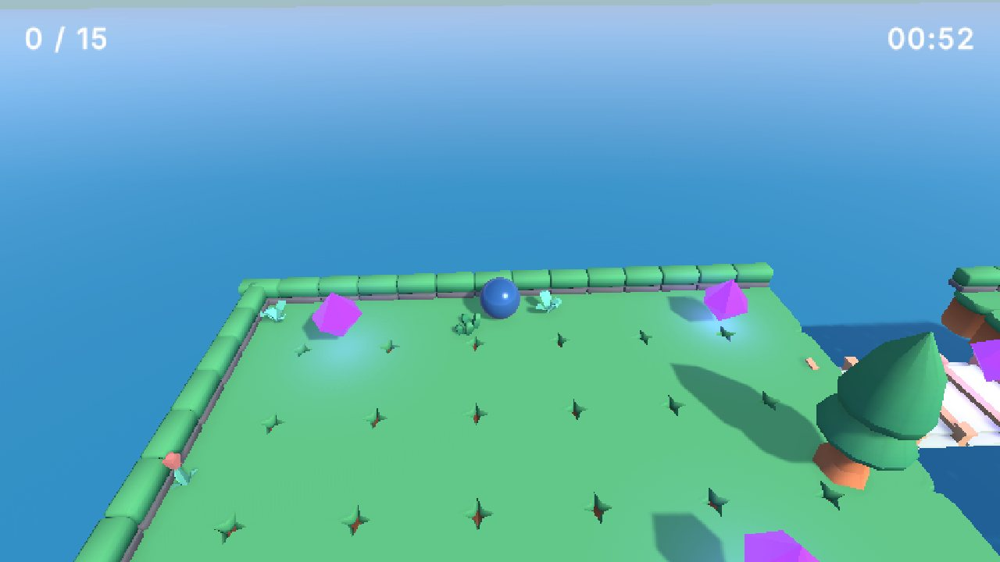
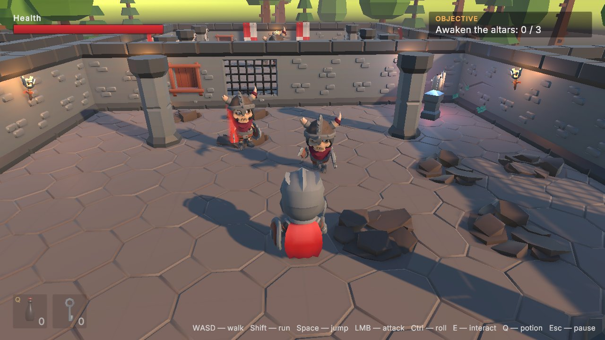

# Unity 6: From Your First Game to Publishing — book projects

Two complete Unity 6 (URP) games from Maksim Boiko's book **Unity 6: From Your First Game to Publishing**: full source code, scenes and assets. The code matches the book's listings line by line.

<!-- TODO: replace with the Amazon link once the book is live -->
**The book:** coming soon on Amazon (Kindle and paperback).

| | Crystal Collector | Ruins |
|---|---|---|
| Genre | physics arcade | third-person action-adventure |
| Book chapter | 10 | 27–28 |
| Play in the browser | [▶ Play](https://livelypuer.github.io/unity6-book-projects-en/crystal-collector/) | [▶ Play](https://livelypuer.github.io/unity6-book-projects-en/ruins/) |
| Windows / macOS | [Download](https://github.com/LivelyPuer/unity6-book-projects-en/releases/latest) | [Download](https://github.com/LivelyPuer/unity6-book-projects-en/releases/latest) |

**Play online:** [https://livelypuer.github.io/unity6-book-projects-en/](https://livelypuer.github.io/unity6-book-projects-en/). Ready-made Windows and macOS builds of both games are in [Releases](https://github.com/LivelyPuer/unity6-book-projects-en/releases/latest).

## Crystal Collector

Roll a ball across floating islands and collect every crystal before time runs out, without falling off or getting hit by spike balls. Small but complete: main menu, level, timer, win and lose screens, pause, sound and music, particles and post-processing.



**Controls:** WASD — roll, Space — jump, Esc — pause.

## Ruins

A knight explores ancient ruins, fights skeletons, finds a key, pulls a lever, awakens three altars and defeats the Guardian—a two-phase boss with clearly telegraphed vulnerability windows. Combat has weight: a blade trail during active frames, sparks, hit stop, camera shake and impact sounds. Shrines save the game and become respawn points.



**Controls:** WASD — move, Shift — sprint, Space — jump, LMB — attack (up to a 3-hit combo), Ctrl — roll, E — interact, Q — potion, Esc — pause. Gamepad supported.

What's inside `Ruins/Assets/_Project`:

| Folder | Contents |
|---|---|
| `Player` | input, Character Controller movement, combo combat, animation, potions, respawn |
| `Combat` | health, attack tokens (enemies take turns instead of swarming) |
| `Enemies` | skeleton state machine, vision, enemy hitbox, phased boss, arena |
| `Interaction`, `Items`, `Quests` | interaction, items and inventory, doors, lever, altars, shrines, quest |
| `Save` | save system with version migrations, player save, level start |
| `Audio`, `UI` | sounds, adaptive combat music, HUD, pop-ups, pause menu |
| `Core` | shared interfaces, state machine, save IDs |
| `Editor` | save ID validator, build menu and command-line builds |
| `Tests` | EditMode and PlayMode tests |

## How to open

1. Install **Unity 6.3 LTS** (6000.3.26f1 or newer from the 6000.3 branch) via Unity Hub. Add the Windows / Mac / Web Build Support modules if you want to make builds.
2. Clone the repository:
   ```bash
   git clone https://github.com/LivelyPuer/unity6-book-projects-en.git
   ```
3. In Unity Hub choose **Add › Add project from disk** and pick the `CrystalCollector` or `Ruins` folder. The first import takes a few minutes.
4. Open `Assets/_Project/Scenes/MainMenu` (Crystal Collector) or `Assets/_Project/Scenes/Ruins` and press **Play**.

Command-line build (script from Chapter 32):

```bash
Unity -batchmode -quit -buildTarget WebGL -projectPath Ruins \
  -executeMethod BuildScript.BuildWeb
```

Methods: `BuildWindows`, `BuildMac`, `BuildWeb`; output goes to the project's `Builds` folder. Build the web version **first** (or delete `Library/ShaderCache` before it): after desktop builds, the shader cache breaks the web build. From the command line, also pass `-buildTarget WebGL` for the web build: if the editor starts on a desktop target, URP strips every Lit shader variant and the web version shows an empty scene.

> **Release builds:** `*-Windows.zip` is Windows 10/11 x64 (unzip and run the `.exe`); `*-macOS.zip` is macOS 13+, Apple Silicon and Intel.
>
> **macOS builds** are not signed. On first launch, right-click the app and choose **Open**.

## The book

**Maksim Boiko. *Unity 6: From Your First Game to Publishing*.** A complete hands-on guide: the editor and C# from scratch, physics, URP graphics and shaders, animation (from Mecanim to procedural), design patterns, AI, saves, optimization, testing, builds and publishing to Steam, Google Play and itch.io.

## About the author

**Maksim Boiko** is the founder of the game publisher Devilime, a game developer and entrepreneur. He organizes game development events and hackathons: the [Gameday](https://gameday73.ru/) festival and the [LimeGames Hack](https://limegames-hack.ru/) hackathon.

Get in touch:

- email — [maxkzboiko@gmail.com](mailto:maxkzboiko@gmail.com);
- Telegram — [t.me/krest_leveosso](https://t.me/krest_leveosso);
- Telegram channel GameDev Ulyanovsk (in Russian) — [t.me/gamedev_ulsk](https://t.me/gamedev_ulsk).

Found a bug in the projects? Open an [issue](https://github.com/LivelyPuer/unity6-book-projects-en/issues).

## Licenses

- **Code** — MIT (see [LICENSE](LICENSE)), free for any use, including commercial.
- **KayKit models** (Adventurers, Skeletons, Dungeon Remastered) — [Kay Lousberg](https://kaylousberg.com/), CC0.
- **Kenney models** (Platformer Kit, Nature Kit) — [Kenney](https://kenney.nl/), CC0.
- **Inter font** — SIL Open Font License.
- **Sounds and music** were synthesized for these projects and ship with the code.

Third-party asset licenses live next to the assets in `Assets/ThirdParty`.
